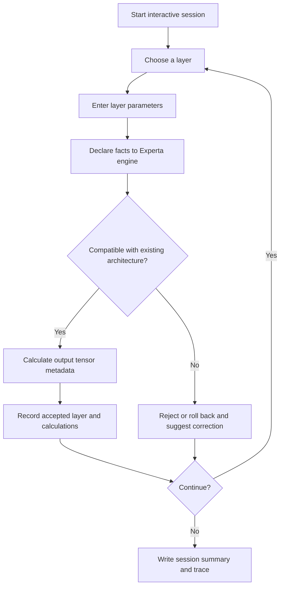

<div align="center">

# NLP Rule-Based Expert System

**An explainable, knowledge-based assistant for designing and validating NLP neural-network layers.**


</div>

## Overview

**NLP Rule-Based Expert System** is an interactive, console-based **knowledge-based system (KBS)** implemented in Python using [Experta](https://github.com/nilp0inter/experta). It guides a user through constructing a sequence of neural-network layers for natural language processing and introductory speech-processing architectures.

Rather than choosing an architecture automatically, the application allows users to select layers and supply their parameters. Its rule engine checks **tensor shapes, data types, layer ordering, and layer-specific constraints**, derives the resulting output shapes, and provides corrective suggestions for incompatible choices.

> **Scope:** This project reasons about *network architecture and tensor metadata*. It does **not** train neural networks, execute Transformer layers on real tensors, or automatically generate an optimal model.

## Key Features

- **Interactive layer selection:** Build an architecture one component at a time through a command-line interface.
- **Rule-based validation:** Apply explicit facts and compatibility rules using the Experta inference engine.
- **Tensor reasoning:** Track shapes, data types, and metadata as layers are added.
- **Transformer components:** Explore input encoding, normalization, attention, residual connections, and feed-forward layers.
- **Activation and projection layers:** Handle ReLU, GELU, Softmax, and position-wise linear transformations.
- **Speech-module support:** Model audio input and audio framing/windowing while retaining channel information.
- **Corrective guidance:** Reject invalid choices, roll back the attempted step, and offer suggestions where implemented.
- **Traceable output:** Write calculation traces and session summaries to text files.

## How It Works



The system uses user-supplied **layer parameters** and inferred **tensor information** as facts, with organized rules for parameter validation, computations, compatibility, and outputs.

## Supported Layers

| Category | Available components | Primary purpose |
| --- | --- | --- |
| Input encoding | Input Encoding Layer Group | Prepare token and positional representations |
| Transformer | LayerNorm | Normalize features |
| Transformer | Multi-Head Attention Layer Group | Represent attention transformations and their internal tensors |
| Transformer | Residual Connection Layer | Model skip-connection constraints |
| Transformer | Feed-Forward Network Layer Group | Model two projections with an internal activation |
| Activations | ReLU, GELU | Element-wise nonlinearities |
| Activations | Softmax | Convert logits into probabilities; terminal in the implemented workflow |
| Projections | Position-wise Linear Layer | Change the final tensor dimension; create hidden representations or logits |
| Speech | Audio Input Layer | Represent sampled audio with a preserved channel dimension |
| Speech | Audio Framing + Windowing Layer | Model overlapping audio frames and windowing |

### Transformer tensor notation

The implementation uses the batch-oriented shape convention:

```text
(B, N, d)
```

where `B` denotes batch size, `N` sequence length, and `d` feature/model dimension.

**Feed-forward network:**

```text
Input               (B, N, d)
First projection    (B, N, d_ff)
ReLU or GELU        (B, N, d_ff)
Second projection   (B, N, d)
Output              (B, N, d)
```

**Position-wise linear projection:**

```text
(B, N, input_dim) -> (B, N, output_dim)
```

Depending on the chosen purpose, its output metadata can represent a hidden tensor or logits. Softmax accepts logits and produces probabilities.

### Compatibility examples

The rule set includes constraints against directly stacking certain activation layers (such as `ReLU -> GELU`), and treats Softmax as a terminal layer. These are **project-specific expert-system rules**, not claims that every such operation is mathematically impossible in all neural networks.

## Speech Processing

### Audio input

The Audio Input Layer describes a waveform using:

```text
(batch_size, samples_per_channel, channels)
```

It gathers duration, sampling rate, channel count, bit depth, and batch size, and derives:

```text
samples_per_channel = duration_seconds * sample_rate
```

### Framing and windowing

The framing layer represents overlapping windows:

```text
Input:  (B, samples_per_channel, channels)
Output: (B, num_frames, frame_length_samples, channels)
```

Parameters include frame length, hop length, and the window function (**Hann**, **Hamming**, or **Rectangular**).

```text
frame_length_samples = sample_rate * frame_length_ms / 1000
hop_length_samples   = sample_rate * hop_length_ms / 1000
num_frames           = 1 + floor((samples_per_channel - frame_length_samples) / hop_length_samples)
```

For example, with 2 seconds of stereo audio at 16 kHz, a 25 ms frame and a 10 ms hop:

```text
Input:  (1, 32000, 2)
Output: (1, 198, 400, 2)
```

The channel dimension is preserved in the resulting shape.

## Technology Stack

| Technology | Role |
| --- | --- |
| Python | Application and expert-system implementation |
| Experta `1.9.4` | Fact- and rule-based inference |
| `frozendict 1.2` | Declared project dependency |
| `schema 0.6.7` | Declared project dependency |
| Command-line interface | User interaction and reporting |

The exact pinned dependencies are listed in [`requirements.txt`](./requirements.txt). Because these are older packages, compatibility may depend on your Python version and environment.

## Getting Started

### Prerequisites

- Python 3 and `pip`
- Git (optional, for cloning)
- A terminal or command prompt

### 1. Clone the repository

```bash
git clone https://github.com/MohammedAbdelkarem/NLP_Rule_Based_Expert_System.git
cd NLP_Rule_Based_Expert_System
```

### 2. Create a virtual environment

**Linux / macOS:**

```bash
python3 -m venv .venv
source .venv/bin/activate
```

**Windows PowerShell:**

```powershell
py -m venv .venv
.venv\Scripts\Activate.ps1
```

### 3. Install dependencies

```bash
python -m pip install -r requirements.txt
```

### 4. Run the application

```bash
python main.py
```

Follow the interactive prompts to select layers and provide their parameters. The application evaluates your selections against its rule base as you build the sequence.

> **Compatibility note:** Installation and execution commands reflect the repository documentation and entry point; a full runtime smoke test was not performed for this README.

## Generated Outputs

After a session, the project writes files under `outputs/`:

| File | Purpose |
| --- | --- |
| `outputs/calculation_trace.txt` | Records calculations and the layer-processing trace |
| `outputs/session_summary.txt` | Summarizes the constructed session and its outcomes |

## Repository Structure

```text
NLP_Rule_Based_Expert_System/
├── facts/                    # Fact definitions and tensor/layer metadata
├── rules/
│   ├── common/               # Shared rule behavior
│   ├── transformers/         # Encoding, normalization, attention, residual, FFN
│   ├── activations/          # ReLU, GELU, Softmax and compatibility
│   ├── projections/          # Position-wise linear projections
│   └── speech/               # Audio input and framing/windowing
├── utils/
│   ├── printing/             # Module-specific console formatting
│   └── print_helpers.py      # Compatibility printing facade
├── outputs/                  # Generated session logs and summaries
├── engine.py                 # Experta knowledge engine and orchestration
├── prompts.py                # Interactive user prompts
├── main.py                   # CLI entry point
├── requirements.txt          # Python dependencies
└── README.md
```

For the complete implementation, explore the detailed subpackages under `rules/`, including their parameter, calculation, output, and compatibility rules.

## Design Highlights

- **Explicit knowledge representation:** Rules and facts capture architectural constraints instead of burying them in a monolithic procedural flow.
- **Modular inference logic:** Transformer, activation, projection, and speech rules are organized separately.
- **Explainable decisions:** Users can inspect why configurations are accepted or rejected.
- **Metadata-driven validation:** The system reasons about shapes and semantic tensor types rather than numerical tensor execution.
- **Incremental construction:** The user remains responsible for selecting architecture order.

## Possible Future Improvements

The following are proposed enhancements, **not currently documented features**:

- Expand coverage to embeddings, convolutional and recurrent layers, and full language-model heads.
- Export accepted architectures to diagrams or machine-readable formats.
- Add automated unit tests for shape propagation, invalid transitions, and rollback behavior.
- Support additional audio transformations such as spectrogram extraction.
- Validate compatibility across more Python versions and modernize pinned dependencies.
- Optionally generate PyTorch/Keras skeletons from validated layer specifications.

## Contributing

Suggestions, bug reports, and improvements are welcome. Open an issue or submit a pull request describing the proposed rule, expected behavior, and test cases.

## Authors

Developed by:

- **[Alaa Daloo](https://github.com/AlaaDaloo)**
- **[Mohammed Abdelkarem](https://github.com/MohammedAbdelkarem)**

## License

No license is asserted here. Consult the repository for an explicit license before assuming redistribution or reuse permissions.

---

<div align="center">
  <sub>Exploring explainable AI through rules, neural-network structure, and tensor reasoning.</sub>
</div>
